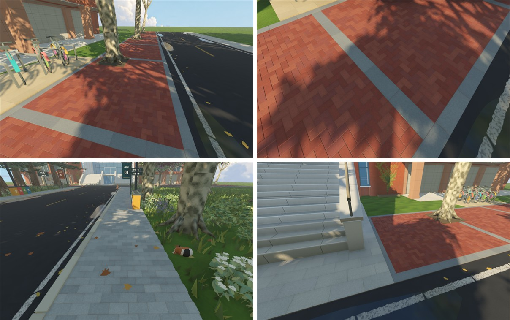
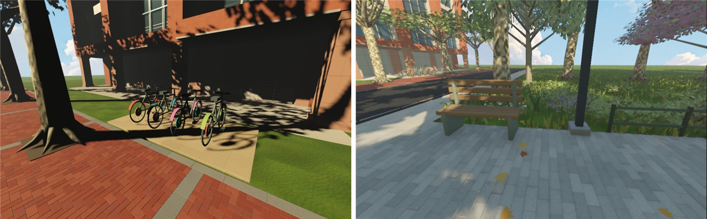

# 科大云宇宙 · PC 校园环境美术移植规范

版本 1.0 · 2026-11-19 · 适用于原项目 PC 可游玩校园的环境改模、区域扩建和美术验收。

**美术基准取自图书馆写实样景。** 沿用它低饱和、舒适的日光与天空底色，以真实科大校园的尺度、建筑和植物为骨架。青春感放在玩家走近能发现的地方：社团海报、不同涂装的自行车、树影里的落叶、草地上打盹的猫。全校共享这套表达方式，各片区保留自己的建筑、树种、道路和生活痕迹。

**第一次执行就做这一条路线：图书馆南门 → 馆前横向马路 → 林荫道第一段。** 美术同学先读第 1–7 节，程序和技术美术重点读第 8–10 节，交付时共同填写第 11 节。文中的“图书馆样例”是当前场景的制作尺度或摆位数据；用于其他地方前，请先核对当地的实景与可通行空间。

## 1. 画风与参考取舍

| 遇到的选择 | 项目采用的处理 | 在游戏里怎么看 |
|---|---|---|
| 动漫气息与校园实感 | 从《异环》的城市步行体验借鉴街头信息密度、树叶层次和有用途的道具，从《原神》和日本青春校园动画借鉴视线焦点、季节和日常叙事。以写实样景定光色；PUBG、GTA 系列的参考价值在于材质、环境磨损与尺度。道具图案使用本项目的校园内容。 | 沿路先认出科大建筑与入口，走近再看到车漆花纹、公告和猫。单纯调高饱和度不能解决内容单薄。 |
| 低饱和与辨识度 | 红砖、树叶、天空和柏油各有色相；靠明度、冷暖、粗糙度和轮廓分层。少量鲜色集中在车、桶、海报或路锥上。 | 在树荫里能分辨黑猫、树干和柏油；在阳光下能分辨天空、云亮面、浅石和窗框。 |
| 细节密度与观看舒适度 | 先做远看的建筑体量和树冠，再做中景窗洞、树枝和设施，最后补近景砖缝、叶脉、漆裂。道路中央、入口和指路牌周围留出清楚的视线。 | 用第一人称连续走一段，观察细纹是否闪动、亮区是否刺眼；再用第三人称检查行路方向与角色轮廓。 |
| 现有版本与本次范围 | 当前集中做 PC；同一片区只维护一个可发布的环境外观。本轮图书馆样板不新增学生群演，原项目玩家、校园角色、动物和互动照常工作。旧 Diorama、早期动漫对照图可用于回顾。 | 评审从主游戏入口进入；标明截图来自主游戏还是独立样景。 |

## 2. 从地图和照片建立米制底图

1. **确定位置。** 以 OpenStreetMap 的道路、建筑轮廓和校界作底，结合校园 GIS、官方总图及卫星影像核对道路衔接、建筑朝向、入口、草坪和相邻关系。沿用原项目米制坐标、片区边界和已有模型定位。底图与校园新建或改建情况冲突时，注明资料日期及采用理由。
2. **确定外观。** 收集校园 GIS 街景、同校区官方照片、现场照片、公开校园影像或视频。对齐同一入口的正面、斜侧、沿街和人眼高度视角。登记来源、方向、季节和可见范围。截图上的地图按钮、标记、文字浮层属于界面。
3. **记录把握度。** 在片区记录中区分“现场或资料确认”“照片比例推算”“美术补全”。优先用门扇、台阶、标准砖、成年行人作比例尺；照片透视很强时，用第二个方向复核。资料不足的背立面、遮挡区和室内允许近似，留出日后替换的边界。
4. **先走白模。** 在 Godot 里放入已有玩家，走完路口、台阶和门洞，再决定窗分格、树冠、设施与贴花。Blender/Python 负责可控的批量建模与变体，Godot/GDScript 负责装配、材质、交互和实机验收。手机适配和引擎更换另行评估。
5. **AI 是辅助制作手段。** Atlas 类开放世界工具可用于构图探索，Meshy 类图生 3D 可用于道具草模或轮廓备选。生成结果按照片重新校尺、查背面和拓扑、整理材质与碰撞、制作远景版本；记录输入来源与资产使用条件。楼体定位、通行边界和最终风格以项目数据与实机画面为准。

## 3. 建筑、玻璃与入口

| 部位 | 模型与材质规则 | 图书馆验收动作 |
|---|---|---|
| 体量与进深 | 地标先建主次体块。按实景分别处理内陷窗、连续窗带、凸出的砖墙、楼板挑出和架空层。窗台、窗洞侧壁、过梁、檐底与立柱应有实体厚度，远处保留主轮廓。 | 从道路斜看图书馆，能看到凸墙侧面、内窗阴影，一楼柱子后能看进架空空间。 |
| 立面红色分区 | 主塔可偏暖砖红，翼楼可偏浅陶红，窄窗侧壁可偏深红。先按建筑构件、砖或板材分区，再在区内加入轻微变化。区分墙面本色与太阳造成的明暗。 | 并排查看正面、斜面和阴影下的楼体，三个视角都能辨认分区；砖缝尺度在跨构件时合理收口。 |
| 砖石交接 | 一个可见表面有一个明确的材质归属；用拆面、裁切、洞口或有实际厚度的包边结束交界。贴花只负责表面信息。检查重叠砖墙、穿柱饰面、错误 UV 比例和远处闪烁。 | 横移镜头贴近砖柱与灰石交界，石面连续，砖纹到边缘结束，侧看无悬浮薄片。 |
| 门前玻璃 | 依实景恢复银灰门框、后退的玻璃幕墙、上方窗带、门扇和分格。区分外层玻璃、内门厅、顶棚与背墙；靠角度变化的反射、受控透明度及粗糙度呈现树影和天空。 | 正看能看出门厅深度，侧走时反射发生变化；门扇和固定玻璃可区分。 |
| 室内光 | 灯具有壳体、厚度、安装位置和照射对象。将灯放进门厅或顶棚，让墙面或地面接到适量光，白天仍保留室内阴影。反射探针只覆盖需要的局部范围。 | 从侧面移动时看得到玻璃、窗框、灯具之间的视差；门厅没有一排贴在玻璃上的发光矩形。 |
| 台阶、通廊与扶手 | 对照图书馆实景保留两侧上行楼梯、平台和中间较低入口。按踏步与平台高度制作连续可走碰撞，扶手、柱脚、墙角接地。金属顶部和朝天边缘可略呈日晒泛黄、变哑，遮蔽面保留原色。 | 用主游戏人物从两侧上楼、在平台转身、进出登记的入口，再下楼；第三人称相机经过柱子和栏杆时也能看清方向。 |
| 海报与楼体示意图 | 主入口完整呈现玻璃。社团、原创动漫海报集中放到横向道路附近架空层的实墙公告栏，可同列陈列楼体示意图。按阅读距离决定纸面规格，有背板、边框和边距。 | 样景普通海报约 59.4 × 84.1 厘米，中心高约 1.58 米。用玩家站旁对照，一张纸明显小于人高，靠近读、远处识别为公告栏。 |

[查看图书馆门厅样景](art_migration_refs/entry.jpg)

## 4. 道路、铺装和雨后痕迹

**先定路权与连接，再定砖纹。** 图书馆示意图中的红色和灰白色地面均属人行空间，黑色为柏油车行道，绿色为草坪。馆前横路与林荫道形成路口；台阶出口接灰色铺装，沿街红砖步道和草坪各自连续。行政楼在这张示意图中只作方位参考。移植前在主图核对路宽、路缘、排水口、树池和相邻片区的接缝。

| 表面 | 铺设与老化 | 现场检查 |
|---|---|---|
| 红色人行步道 | 图书馆按约 20 × 10 厘米的红砖做 **90° 人字铺**，横竖砖互相咬合。用灰色长砖横向分段，外沿灰砖收边，树池和转角处有裁砖。样景分隔带中心间距约 4.25 米、砖缝约 3 毫米。 | 低头能读出单砖和转向，走远能读出灰带分区。砖面有细颗粒、微倒角、轻微高低差和同色系变化。 |
| 灰色人行空间 | 林荫道样例用约 30 × 15 厘米灰砖，馆前平台、横路旁样例用约 60 × 30 厘米浅灰铺石。相邻排错半砖；边线、台阶底部、树池和排水设施有明确收口。灰石与红砖的颗粒、反光和尺度分别调整。 | 同一镜头能读出入口、步道与柏油三种地面。斜光显出砖棱，行走时碰撞平顺。 |
| 柏油、路缘、标线 | 柏油体现骨料；路牙有侧面、顶面和分段接缝。适用路段设置黄色中央虚线、路边白色实线；对照实景决定路口断线、出入口和排水格栅的位置。标线边缘轻度褪色，局部脱粒或有细裂，露出下层柏油。 | 从步行高度远看导向仍清楚；近看边缘有磨损。检查道路接头处的标线朝向，以及标线和路面有无闪烁。 |
| 起伏与积水 | 做很浅的横坡与局部低洼；湿痕沿低处、路缘或排水方向出现。宽处成片、窄处拖尾，薄水边缘过渡到湿柏油，再到干面。水面近水平，倒影随视角变化。配分布时留出长段干路，左右错开、大小不同，路口优先保持清晰。 | 最新样景为林荫道两处、馆前横路一处。其他路段按低点决定是否有水，允许整段干燥。沿路望过去不应一眼看出重复周期；同一机位改前、改后对照。 |
| 草地与落叶 | 草地有底色纹理、草叶和局部裸土；树下、路牙和挡风边缘聚集较多。保留原有掌状／枫叶状落叶，加入扇形有缺口的银杏叶。大小、朝向、干湿和颜色成组变化，落点与附近植被及风向讲得通。 | 近处认得两种叶形，远处只读到零星暖色；车道中央仍能看清标线。切换镜头检查落叶贴地、远处稳定。 |

[查看积水修改前后，左旧右新](art_migration_refs/puddles.jpg)

## 5. 树木、灌木、草与爬山虎

- **按树种制作。** 对照校园街景辨认树干、分枝高度、树根、冠幅和枝叶密度。例如法桐／悬铃木表现分叉主枝、斑驳树皮和不规则阔冠；雪松类表现层状外伸的枝盘、局部下垂枝梢和细密针叶。胸径、根盘、树池合乎同一株树的体量。针叶林使用和针叶轮廓相配的枝叶及树皮材质。
- **每种主要树型准备十种不同形态。** 先做十张远景剪影，再做细枝叶。变体应在高宽比、冠顶偏向、分叉层数、侧枝伸出、偏冠、透空和树冠底部高度上有肉眼可见的差异。可共用纹理和枝叶模块；旋转、缩放、换色用于二次变化。样景的 `plane`、`cedar`、`grove` 是现有资产组名；其他片区先核实真实树种，再决定复用哪组。
- **分布既像种植，也像生长。** 行道树保留校园实际的列植节奏；在合理范围内改变朝向、年龄与树冠伸展。按树种用固定种子打乱十个变体，一轮取完再洗牌，跨轮避开紧邻重复。用道路远端和对面人行道检查，不规则的树冠应在远看时也认得出来。
- **密度靠层次。** 林荫道实景一侧是高大浓密的针叶群，另一侧可见更明亮的阔叶树。分别组织树干、主枝、次枝、叶簇与枝间天光，向路面投下疏密不一的树影。走在树下应能看见枝条和空隙。连续的绿色团块、云朵状树冠或成排复制的树尖都要返工。
- **补足路边三层。** 高处乔木决定遮阴，中层有小灌木、绿篱、开花植物，低处为草丛、地被和落叶。植物以小群落分布，在树池、草坪边或栏杆内有疏有密。保留草坪休息区、猫的轮廓、停放区和人行道净宽。
- **爬山虎从土里长出来。** 先找墙根有种植土或种植槽、能附着的连续灰墙或砖石实墙，再沿墙生成主蔓、分枝、侧梢与叶片。根部连到土面，枝蔓有粗细与分叉，外围可见少量探出的梢；窗、门、玻璃、招牌和架空通道留空。株形有主次，允许一面繁密、另一面短小。以叶群形成绿、黄绿、橙红至深红的秋色过渡，让朝向、遮阴和个体差异打破整齐色带。换季节或换墙面需重做分布。
- **看图顺序。** 先以远景树冠剪影判断品种和形，再在树下看针叶／阔叶、透空和投影，最后沿墙近看根、藤和叶的连接。高密细节集中在玩家可接近的位置。 [树冠变体样景](art_migration_refs/crowns.jpg)

## 6. 街具、校园叙事与动物

| 对象 | 制作和放置规则 | 必查问题 |
|---|---|---|
| 自行车、停车架 | 在有铺装且可推入的停车位成组停放。不同车架、挡泥板、轮毂可做彩色涂装，橡胶、金属和车漆各有质感。按含车把、脚踏、轮胎的完整外形校间距。 | 从正面和侧面看车轮接地、车把不互穿；树干、外露树根、树池、灌木以及车架金属环均有净空。 |
| 长椅、路灯、栏杆 | 先画灯座、椅脚、椅背和栏杆的占地，再布置模型。长椅面向可停留的空间，前方留通行面。将模型和碰撞体一起移位。 | 正侧视检查杆穿椅、栏穿靠背和旧位置的隐形碰撞。已修样景中，两侧路口长椅距各自灯座沿路净距约 0.61／1.16 米；它们是该处验收结果。 |
| 标志、摄像头、路障、垃圾桶 | 路标面向来路；摄像头有支架、安装杆和镜头朝向；圆锥形路障有底座和褪色反光带，按入口或临时管理需要成组。分类垃圾桶可用不同颜色，标识设在阅读面。 | 行进方向能读牌，设施不挡主入口、台阶或导览落点；把杆件底座、横向伸出的支臂也算入占地。 |
| 黑猫与三花猫 | 图书馆两侧草地安排不同个体，可采用黑猫揣爪趴卧、三花蜷卧。先看参考中的骨架与卧姿，再细化圆润口鼻、耳根、下颌、前爪和尾巴；眼睛比例收敛、眼睑放松。黑猫借毛发明暗读出轮廓，三花用连续毛区组织黑、橙、白。 | 在玩家眼高和蹲低近景都应温和、像在休息。检查眼睛突亮、尖脸、头身接缝、爪子穿地、尾巴穿身，以及草遮住整张脸。 |
| 生活气息 | 彩色车漆、原创活动海报、落叶和动物各有地点和用途。树荫里可有休息点，架空层有公告，路口有导向。给不同区域安排不同组合。 | 远处读地点，中距离读用途，近处能发现细节。校园的青春感不依赖统一高饱和滤镜或满街重复海报。 |

[查看黑猫和三花猫的休息姿态](art_migration_refs/cats.jpg)

## 7. 天空、日照、材质和季节

1. **沿用写实样景的蓝天底色。** 天空有清朗感和活力，画面最亮处保留层次。地平线附近为分开、留有蓝天间隔的积云；用大而柔软的团块，顶部受光、内部有转面、下部有阴影，表现棉絮感。头顶可加少量纤细卷云或成小片的卷积云。检查抬头、逆光和水平视角；全天空铺满云层造成阴天感就要减量。 [天空样景](art_migration_refs/sky.jpg)
2. **舒适度优先于参数一致。** 以玩家从阴影走到亮处的过程调太阳、天空补光、曝光和色调映射；检查浅色铺石、玻璃边、金属扶手和云高光是否还能分辨材质。灰墙与树荫有层次，晴天仍有明确的阴影方向。天空图或预烘焙效果可以表现云的体积；实时体积云的成本单独测试。
3. **材质由表面和使用方式决定。** 为主要材质设真实米制纹理尺度，分开处理底色、粗糙度、法线和必要的金属性。玻璃在斜视时更易读出反射；柏油有细颗粒；花岗岩有微倒角；涂漆金属只在受日晒、手握或磕碰处出现相应磨损。避免把固定树影、白色高光或整片污渍画死在底色里。
4. **保持同一片区时空一致。** 样景的秋意来自少量银杏落叶、爬山虎转色和校园陈设。调整其他片区时先记录季节、太阳方向与实景特色。若需改全局环境，另取湖边、浅色教学楼、密林三处同机位复核；只因一栋楼太亮，先查其材质与局部反射。

## 8. Blender → Godot → 主项目的装配规则

| 环节 | 实际操作与交付 |
|---|---|
| 找到修改源 | 先判断问题属于源模型、材质、布置数据、灯光还是碰撞。轮廓失真回 Blender，砖色失真先查材质，杆穿椅先查摆位。脚本生成的资产连同生成源一起维护，避免重新导出后丢失修正。 |
| 资产制作 | Blender 采用米制，设置可理解的原点、朝向、接地面、材质槽与命名；立面开洞、植物剪影、倒角和 LOD 在正确尺度下制作。导出 GLB 后核对法线、UV、透明排序、材质槽、比例和依赖。以门高、已知铺砖或玩家复核导入尺度。 |
| 区分可复用与专用 | 公共资产包括树族、灌木、砖材、路漆、通用街具与实例化方法。地标专用资产包括图书馆塔楼分色、特定门框、窗洞、馆牌、公告栏和入口关系。把可复用代码与依赖放到正式资产或脚本目录，检查贴图和着色器路径；保留样景用于同机位对照。 |
| 坐标与材质 | 主游戏和样景共用 `south_library.glb`。主项目按 manifest 的 `local_placement` 安装模型，图书馆局部 +Z 朝门外；整校设施还有直接使用校园坐标的情况。局部位置通过同一个建筑变换转换一次，核对转角、标高及门前道路。在 `c.style(model)` 后应用需要覆盖的材质，检查远景模型也保留同一红色分区。 |
| 正式场景接入 | 从 [片区装配](../godot/scripts/library_district.gd) 逐项接入。按片区数据替换原可见面，旧铺装在对应区域裁切，碰撞连续。主游戏继续管理玩家、镜头、全局环境、楼体碰撞与参观门；样景内的独立相机、太阳、地板、自动门触发器各有测试用途。整套样景直接实例化会造成重复控制和重叠表面。 |
| 游戏系统交界 | 门可换材质与框体，开合、可进门范围和室内登记由原参观系统处理。更新碰撞和通行后，用原玩家第一、第三人称验证。导览标记、快速前往、校园 NPC 对话／知识来源、行动 Agent 的找人和前往、ENet 联机出生与同步，按受影响的路线回归。 |
| 协作 | 一次改一个可验收的区域或资产族，独立分支提交；先记旧场景基线，保留可回退的改动边界。模型、贴图、生成脚本和摆位清单一起提交，在评审说明里保存资料依据与实机差异。 |

**第一轮接入次序。** ① 仅把图书馆立面和玻璃装到主游戏，测两个生产入口。② 以已有馆前边界铺砖、接上横路和林荫道，测地面接缝。③ 依树位、停车区和净空放树、街具、猫，再加草和落叶。④ 在主游戏日光下检查天空与反射，测同路线性能。⑤ 试点通过后，先推广公共材质和树族，再按各片区自己的照片改建筑；普通教学楼、宿舍和运动区分别选一个代表视角复核。

## 9. 性能与远中近细节分配

| 玩家看到的距离 | 保留什么 | 优先节省什么 |
|---|---|---|
| 近景，玩家可碰到或停下细看 | 砖边、窗洞和门框厚度、车把、猫脸、树干、扶手和可走台阶。 | 重复砖块与叶片按网格、材质和空间区域用 MultiMesh 批量绘制；台阶可用专用行走碰撞，装饰小件共用简化碰撞或按需省略。 |
| 中景，街道对面和路线前方 | 窗的层次、建筑色块、树种和冠形、成组灌木、路缘与标识。 | 小砖倒角、砾粒、细裂更多交给贴图、法线与粗糙度；合并静态构件，复用材质。植物按空间分批，降低透明叶片相互覆盖与阴影成本。 |
| 远景，街道尽头与跨片区 | 楼体轮廓、树冠之间的空隙、道路轴线和地标。 | 接已有网格 LOD、HLOD 或远景替身，设置平稳过渡。检查剪影、季节颜色和玻璃亮度在切换时连续，按镜头测定切换距离。 |

性能比较使用同一台 PC、分辨率、画质档、天气、路线和窗口焦点。记录平均帧时间、P95 帧时间、绘制调用、可见实例与显存／内存变化；可用时分开看 CPU 和 GPU。覆盖树下转身、临近玻璃、回望林荫道和跨区行走。先依据 [项目性能规范](PERFORMANCE_STANDARD.md) 的同条件基线和扩建复核阈值定位退化，再决定优化透明植被、阴影、反射、几何或加载。样景截图和高端电脑的静止帧率都不足以确认整校发布性能。

## 10. 实机验收与回归表

从 PC 主游戏启动，图书馆可用 `campus/run_game.ps1 -Library` 直达。记录机位坐标、朝向、视场、光照与画质，同机位留一张改前、一张改后；截图配一次连续实走。下表按本次修改选取适用行。

| 验收机位／动作 | 通过时应观察到 | 典型返工信号 |
|---|---|---|
| 沿林荫道走向馆门，第一与第三人称各一次 | 树种可辨，远冠多样，路标和入口读得清，天空留蓝 | 同形树列、绿色云团、云铺满、高光刺眼、树叶远处闪动 |
| 馆前正面、斜侧和贴墙横移 | 红墙分区、架空层、内窗侧壁、柱后空间与玻璃反射有层次 | 砖与灰石抢面，玻璃像贴图，灯跟着镜头贴在窗上 |
| 走两侧台阶，进出登记的两处门 | 玩家通过、门能正常开合，镜头不穿柱；公告尺寸合人高 | 台阶卡脚、门有双层碰撞、门面被巨幅海报挡住 |
| 低头看一块砖，再沿路追踪灰带和标线 | 砖向与收边连续，微起伏可见，雨后路段干湿不对称 | 巨砖、均匀湿亮、每隔相同距离出现椭圆水洼、标线漂浮 |
| 沿车位、长椅、绿化带两侧绕看 | 车轮、椅脚接地，车把、树根、灯座和椅背各有空间 | 自行车陷树与灌木、路灯穿过椅面、挪动物体后旧碰撞还在 |
| 观察墙根和草地 | 能沿主藤追到土面，猫姿态放松，叶形和种植区域相符 | 藤漂在玻璃上、全墙机械渐变、猫眼突亮或枝叶穿脸 |
| 从相邻片区走入、跳跃、转身、切画质 | 路面连续，角色和相机可通行，远景过渡稳定，性能有前后数据 | 区域裂缝、LOD 跳色、转身掉帧、导览落点落在树池或围栏内 |

已有工程入口供复用：[整校图书馆双门与多机位](../tools/validate_library_full_campus.gd) · [道路表面](../tools/validate_road_surfaces.gd) · [地面接缝](../tools/validate_ground_seams.gd) · [玩家通行](../tools/validate_game_traversal.gd) · [整校性能采样](../profile_campus_performance.ps1)。记录哪些实际运行、哪些留待带后端或双端联机环境核验。

## 11. 每次改模的交付单

| 必填项 | 填写内容 |
|---|---|
| 地点与目标 | 片区、资产名、原问题；玩家从哪条路、什么距离会看到。 |
| 依据与判断 | 实景图、总图、拍摄方向；确认项、估计尺寸和美术补全部分。 |
| 修改落点 | 生成源／GLB／材质／片区数据／碰撞；公用资源会影响哪些其他地点。 |
| 视觉对照 | 同机位改前与改后、玩家眼高近景、远景或第三人称；涉及材质时增加移动斜视。 |
| 通行与性能 | 实走路线与结果、碰撞与交互、同条件帧时间；未测项目和已知问题单列。 |
| 复用与反馈 | 哪项成为通用资产，哪项仅限本地；评审反馈、修订内容、确认日期和可回退提交。 |

**交付示例。** “图书馆侧面停车区／四辆自行车。原排位与针叶树根、花丛重叠；改至邻近硬质铺装，按包含车把的完整尺寸复核四车互不相交。从正侧面截图核对轮胎接地、树池边界和人行带；车漆可共享，停车区位置仅属此处。” 其他片区沿用这种写法，让下一位建模同学能理解改动，也能复查它。
